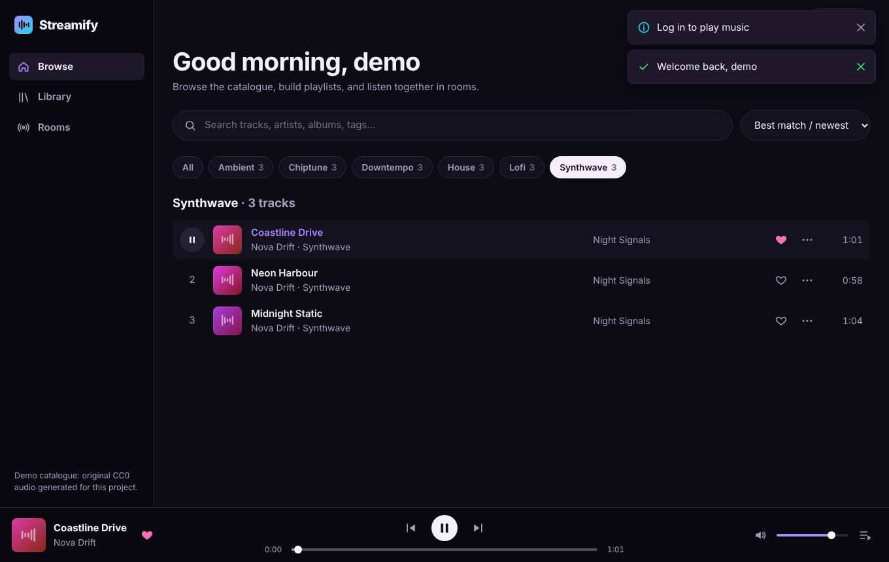
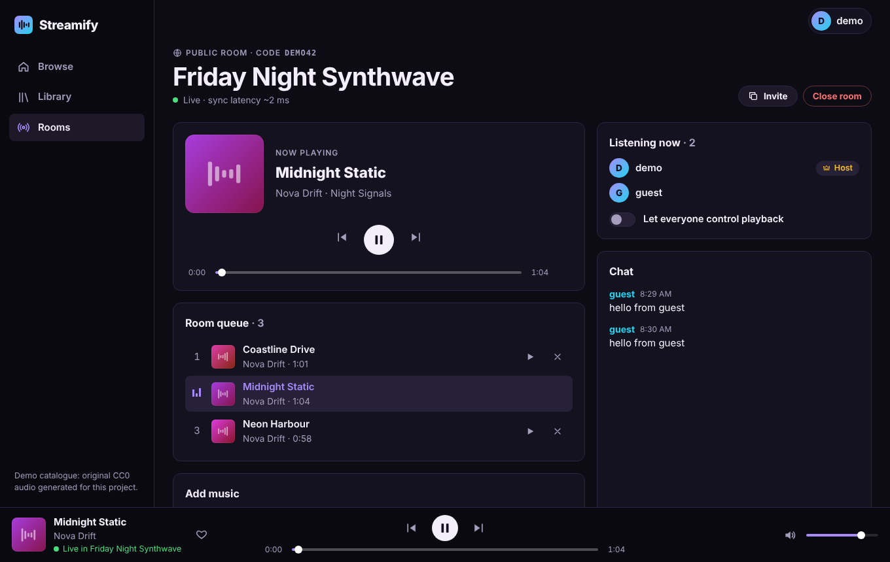
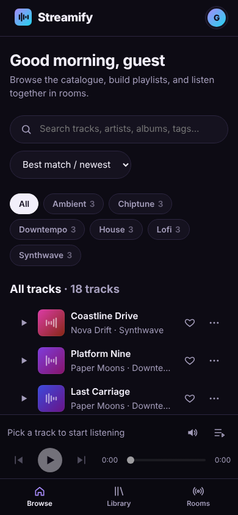

# Streamify

A full-stack music streaming app with **real-time collaborative listening rooms**.
Browse and search a catalogue, build playlists, and listen in sync with friends while you chat.

**Stack:** React 19 + Vite · Node.js + Express 5 (versioned REST API) · MongoDB (Mongoose) ·
Socket.IO · Redis (optional cache) · Docker Compose · Vitest, Supertest and Playwright



| Listening room (host view)              | Mobile                                                                    |
| --------------------------------------- | ------------------------------------------------------------------------- |
|  |  |

> **About the audio:** every track in the demo catalogue is **generated by code in this repo**
> (`server/scripts/synth.js`) and released as CC0. No copyrighted music is included or
> downloaded. The music is simple synthesized loops, so expect demo quality, not studio quality.

---

## Features

- **Accounts:** register, log in, log out, current user. bcrypt password hashes; JWT in an
  httpOnly SameSite cookie; logout revocation; rate-limited auth endpoints.
- **Catalogue:** 18 seeded tracks with genre, mood, tags, BPM, key, year and play counts.
  Full-text search with a prefix fallback, genre filter, sort (newest, most played, A–Z) and
  pagination. Filters live in the URL.
- **Player:** play/pause, seek, next/previous, volume and mute, queue panel, keyboard
  shortcuts, OS media keys (Media Session API), plus buffering, error, retry and
  autoplay-blocked states. Audio streams over HTTP Range requests.
- **Library:** liked songs; playlists with create, view, edit, delete, add and remove
  tracks, and reorder. Playlists can be public or private, with ownership enforced on the server.
- **Listening rooms:**
  - create or join by 6-character code, plus public and private rooms;
  - live participant list and persisted chat (cursor-paginated history);
  - synchronized play, pause, seek, track change and queue;
  - host-only control or "everyone can control" mode;
  - reconnect handling.
- **Performance:** MongoDB indexes matched to the real queries; Redis cache-aside for
  catalogue reads with versioned invalidation and graceful fallback when Redis is down.
- **Quality:**
  - 48 API and real-time tests plus 21 client tests;
  - a Playwright smoke test that drives two browsers through the whole app;
  - ESLint, Prettier, and GitHub Actions CI.

See **[docs/ARCHITECTURE.md](docs/ARCHITECTURE.md)** for the design, data model, sync
algorithm and tradeoffs.

---

## Quick start with Docker (recommended)

Prerequisites: Docker with Compose v2.

```bash
cp .env.example .env
```

Edit `.env` and set `JWT_SECRET` to a long random value. You can generate one with:

```bash
node -e "console.log(require('crypto').randomBytes(48).toString('base64url'))"
```

```bash
docker compose up --build
```

Open **http://localhost:8080**. On first start the API seeds the demo data (it's idempotent,
and controlled by `SEED_ON_START`). Log in with a demo account:

| Email                   | Password    | Notes                                                 |
| ----------------------- | ----------- | ----------------------------------------------------- |
| `demo@streamify.local`  | `demo1234`  | Owns the "Focus Mix" playlist and hosts room `DEMO42` |
| `guest@streamify.local` | `guest1234` | Use it in a second browser to join a room             |

These are local development credentials created by the seed script. Never use them anywhere real.

Useful commands:

```bash
docker compose logs -f server
```

```bash
docker compose exec server node scripts/seed.js --reset
```

```bash
docker compose down -v
```

`--reset` wipes users, playlists, rooms and chat before re-seeding. `down -v` stops the stack and deletes its volumes.

---

## Local development (without Docker for the app)

Prerequisites:

- **Node.js ≥ 22.12** and npm 10+
- **MongoDB 7+** running locally (or `docker compose up -d mongo`)
- **Redis 7+** (optional: `docker compose up -d redis`; the app works without it)

```bash
npm install
```

```bash
cp .env.example .env
```

Edit `.env` and set `JWT_SECRET`.

```bash
docker compose up -d mongo redis
```

```bash
npm run seed
```

The seed generates about 47 MB of WAV audio into `server/storage/audio` and seeds MongoDB.

Then run the API and the web app in two terminals:

```bash
npm run dev:server
```

```bash
npm run dev:client
```

The API runs at http://localhost:4000. Open **http://localhost:5173**. The Vite dev server
proxies `/api` and `/socket.io` to the API, so the browser sees a single origin and the auth
cookie works without any CORS setup. On macOS or Linux, `npm run dev` starts both at once.

### Running without Redis

Set `REDIS_URL=` (empty) in `.env` to disable caching, or just don't start Redis. If Redis
is configured but unreachable, the API logs one warning and serves everything straight from
MongoDB:

- catalogue responses carry `X-Cache: BYPASS`;
- `GET /api/v1/health` returns `"status": "degraded", "redis": "unavailable"`;
- logout revocation falls back to process memory, which covers a single API instance.

---

## Environment variables

All are validated at startup (`server/src/config/env.js`); invalid config exits with a clear message.

| Variable              | Default                               | Description                                                          |
| --------------------- | ------------------------------------- | -------------------------------------------------------------------- |
| `JWT_SECRET`          | — (**required**, ≥ 32 chars)          | HMAC secret for session tokens                                       |
| `MONGO_URI`           | `mongodb://127.0.0.1:27017/streamify` | MongoDB connection string                                            |
| `REDIS_URL`           | `redis://127.0.0.1:6379`              | Redis URL; empty disables caching                                    |
| `PORT`                | `4000`                                | API port                                                             |
| `NODE_ENV`            | `development`                         | `development` \| `test` \| `production`                              |
| `CLIENT_ORIGIN`       | `http://localhost:5173`               | Comma-separated origins allowed by CORS/Socket.IO                    |
| `COOKIE_SECURE`       | `true` in production                  | Secure flag on the auth cookie (needs HTTPS)                         |
| `JWT_EXPIRES_IN_SEC`  | `604800` (7 days)                     | Session lifetime                                                     |
| `AUTH_RATE_LIMIT_MAX` | `20`                                  | Login/register attempts per IP per 15 min                            |
| `AUDIO_DIR`           | `storage/audio`                       | Generated audio location (relative to `server/`)                     |
| `LOG_LEVEL`           | `info`                                | pino log level                                                       |
| `SEED_ON_START`       | `true` (Docker only)                  | Run the idempotent seed when the container starts                    |
| `VITE_API_URL`        | empty (same origin)                   | Client build-time API origin, if the API is hosted on another origin |

---

## Tests and checks

```bash
npm run lint
```

```bash
npm run format:check
```

```bash
npm test
```

`npm test` runs the server and client suites. To run them separately:

```bash
npm test --workspace server
```

```bash
npm test --workspace client
```

Server tests start an in-memory MongoDB with `mongodb-memory-server`. It downloads a
`mongod` binary on first run; to use one already installed, set
`MONGOMS_SYSTEM_BINARY=/path/to/mongod`. The Redis-backed cache tests run when
`TEST_REDIS_URL` is set and are skipped otherwise:

```bash
TEST_REDIS_URL=redis://127.0.0.1:6379/15 npm test --workspace server
```

The server tests cover:

- **Auth:** httpOnly cookie, no hash leaks, case-insensitive duplicates, validation details,
  generic login errors, logout revocation and token replay, tampered tokens, CSRF header.
- **Catalogue:** pagination boundaries and metadata, invalid parameters, genre filter and sort,
  text and prefix search, regex-injection safety, Range streaming (206), auth on streams,
  path traversal, likes.
- **Playlists:** CRUD, validation, dedupe, reorder, ownership (403 vs 404 for private), pagination.
- **Rooms REST and Socket.IO:**
  - handshake auth, presence (including multiple tabs), unknown rooms, payload validation;
  - chat scoped to its room, chat rate limit, cursor history;
  - host-only control, "everyone" mode, seek clamping;
  - exactly-once `ended` handling under a race;
  - reconnect state restoration, room closing, clock sync.
- **Cache:** BYPASS without Redis, API still working with Redis unreachable, MISS→HIT,
  namespace invalidation.

The client tests cover sync maths (expected position, clock offset, drift), formatting,
pagination, and the auth forms (API field errors, CSRF header, redirects).

**Browser smoke test** (optional, uses Playwright and a running, freshly seeded app):

```bash
npm i -g playwright
```

```bash
npx playwright install chromium
```

```bash
npm run seed -- --reset
```

```bash
BASE=http://localhost:5173 NODE_PATH=$(npm root -g) node e2e/smoke.cjs
```

It logs each step, including the measured host/guest playback drift, and writes
screenshots to `e2e/screenshots/`.

---

## API reference (v1)

Base path `/api/v1`. JSON in and out. Errors look like
`{ "error": { "code": "VALIDATION_ERROR", "message": "...", "details": [{ "path", "message" }] } }`.
Every non-GET request must send `X-Requested-With: streamify` (CSRF defence); the web
client does this automatically. 🔒 means authentication is required.

| Method & path                              | Description                                                                                |
| ------------------------------------------ | ------------------------------------------------------------------------------------------ |
| `GET /health`                              | Liveness/readiness, with Mongo and Redis status                                            |
| `POST /auth/register`                      | `{ username, email, password }` → 201 `{ user }` + cookie                                  |
| `POST /auth/login`                         | `{ email, password }` → `{ user }` + cookie                                                |
| `POST /auth/logout` 🔒                     | Revokes the token, clears the cookie (204)                                                 |
| `GET /auth/me` 🔒                          | Current user                                                                               |
| `GET /tracks`                              | `?q=&genre=&sort=newest\|popular\|title&page=&limit≤50` → `{ items, pagination }` (cached) |
| `GET /tracks/genres`                       | Genres with counts (cached)                                                                |
| `GET /tracks/:id`                          | Track detail (cached)                                                                      |
| `GET /tracks/:id/stream` 🔒                | Audio with HTTP Range support (206)                                                        |
| `POST /tracks/:id/play` 🔒                 | Increment the play count                                                                   |
| `GET /tracks/liked` 🔒                     | Liked songs, paginated, newest first                                                       |
| `GET /tracks/liked/ids` 🔒                 | Ids of liked tracks (for heart icons)                                                      |
| `PUT /tracks/:id/like` 🔒                  | Like (idempotent)                                                                          |
| `DELETE /tracks/:id/like` 🔒               | Unlike                                                                                     |
| `GET /playlists` 🔒                        | My playlists, paginated                                                                    |
| `POST /playlists` 🔒                       | `{ name, description?, isPublic? }`                                                        |
| `GET /playlists/:id` 🔒                    | Owner, or anyone if public; private returns 404 to others                                  |
| `PATCH /playlists/:id` 🔒                  | Owner only: `{ name?, description?, isPublic? }`                                           |
| `DELETE /playlists/:id` 🔒                 | Owner only                                                                                 |
| `POST /playlists/:id/tracks` 🔒            | Owner only: `{ trackId }` (deduplicated, max 500)                                          |
| `DELETE /playlists/:id/tracks/:trackId` 🔒 | Owner only                                                                                 |
| `PUT /playlists/:id/tracks` 🔒             | Owner only: reorder with `{ trackIds }` (must be a permutation)                            |
| `GET /rooms` 🔒                            | Public rooms, paginated, with live listener counts                                         |
| `GET /rooms/mine` 🔒                       | Rooms I host                                                                               |
| `POST /rooms` 🔒                           | `{ name, isPublic?, controlMode?: 'host'\|'everyone' }` → room with code                   |
| `GET /rooms/:code` 🔒                      | Room state (queue and playback)                                                            |
| `PATCH /rooms/:code` 🔒                    | Host only: settings (broadcast to members)                                                 |
| `DELETE /rooms/:code` 🔒                   | Host only: closes the room, notifies members, deletes chat                                 |
| `GET /rooms/:code/messages` 🔒             | Chat history, `?before=<messageId>&limit=` (cursor)                                        |

Socket.IO events are documented in [docs/ARCHITECTURE.md](docs/ARCHITECTURE.md#events).

---

## Project structure

```
├── client/                 React SPA (Vite)
│   ├── src/api/            fetch wrapper + endpoint functions
│   ├── src/context/        auth, toasts, library state
│   ├── src/player/         PlayerContext (<audio>), PlayerBar, QueuePanel
│   ├── src/rooms/          useRoom (Socket.IO + sync), chat, track picker
│   ├── src/pages/          route components
│   ├── src/components/     accessible UI building blocks
│   ├── nginx.conf          production static server + reverse proxy
│   └── Dockerfile
├── server/                 Express API + Socket.IO
│   ├── src/config/         validated environment config
│   ├── src/lib/            logger, db, cache, errors, pagination
│   ├── src/middleware/     auth, validation, CSRF, error handling
│   ├── src/models/         Mongoose schemas + indexes
│   ├── src/modules/        auth, tracks, playlists, rooms, health
│   ├── src/realtime/       socket server, schemas, presence
│   ├── scripts/            seed, catalogue metadata, audio synthesizer
│   ├── test/               Vitest + Supertest + socket.io-client
│   └── Dockerfile
├── e2e/smoke.cjs           Playwright browser smoke test
├── docs/ARCHITECTURE.md
└── docker-compose.yml
```

---

## Production build and deployment guidance

> This project has **not** been deployed anywhere. The notes below say how you would do it.

- **Build:** `docker compose build` produces two images. The API image is
  `node:22-alpine` running as a non-root user with a healthcheck. The client image is
  nginx serving the Vite build, with security headers (CSP, X-Frame-Options and others),
  long-lived caching for fingerprinted assets, and a reverse proxy for `/api` and
  `/socket.io`, WebSocket upgrades included. Without Docker, `npm run build` writes the
  static client to `client/dist`.
- **Managed services:** point `MONGO_URI` at a managed MongoDB (for example Atlas) and
  `REDIS_URL` at a managed Redis. Keep both on private networking.
- **Secrets:** inject `JWT_SECRET` from your platform's secret store. Never bake it into an
  image or commit `.env`.
- **HTTPS:** terminate TLS at a load balancer or ingress, keep `COOKIE_SECURE=true` (the
  production default), and set `CLIENT_ORIGIN` to your public origin. `trust proxy` is set to
  one hop.
- **Audio storage:** in production, put audio in object storage (for example S3 or GCS) behind
  a CDN, and use `audioUrl` or signed URLs instead of local disk.
- **Scaling:** one API instance works out of the box. For several instances, add the
  Socket.IO Redis adapter, move presence into Redis, and enable sticky sessions (see the
  architecture doc).
- **Operations:**
  - pino writes structured JSON logs to stdout, with secrets and cookies redacted;
  - `/api/v1/health` is suitable for liveness and readiness probes;
  - CI (`.github/workflows/ci.yml`) runs lint, format, tests and build on every push.

---

## Known limitations

- **Demo audio:** 18 short (48–75 s) synthesized loops, stored as uncompressed WAV, which is
  larger than MP3. There's no transcoding or adaptive bitrate. The audio is original and CC0, but the catalogue is
  intentionally small. Licensed external audio can be referenced with a track's `audioUrl`,
  but no admin UI exists for adding tracks; they come from the seed script.
- **Sync accuracy depends on the network:** rooms align playback using server timestamps,
  clock-offset estimation and drift correction (0.75 s tolerance). Expect tens to hundreds of
  milliseconds of difference between listeners on real networks. Bluetooth and output latency
  isn't compensated. Browsers may block autoplay until you click the "enable audio" prompt.
- **Single API instance:** room presence and the chat rate limiter live in memory (see
  _Scaling_ above).
- **Room mode replaces your local queue**, and the queue isn't restored when you leave the room.
- **Search:** prefix matching (for partial words) falls back to an unindexed regex scan,
  which is fine for a small catalogue but not for millions of tracks.
- **Accounts:** no email verification, password reset, profile editing, or OAuth. Logout
  revokes the current token only, not all sessions.
- **Private rooms are unlisted, not access-controlled:** anyone signed in who has the code
  can join. Playback control is still enforced.
- The `npm run dev` shortcut that starts both apps uses `&`, which assumes a Unix shell. On
  Windows, run `dev:server` and `dev:client` separately.
